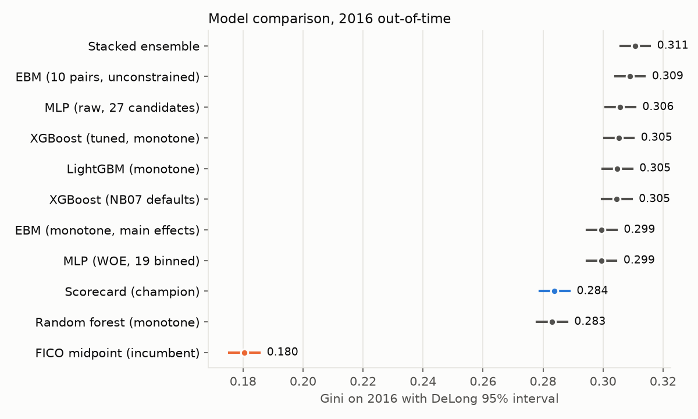
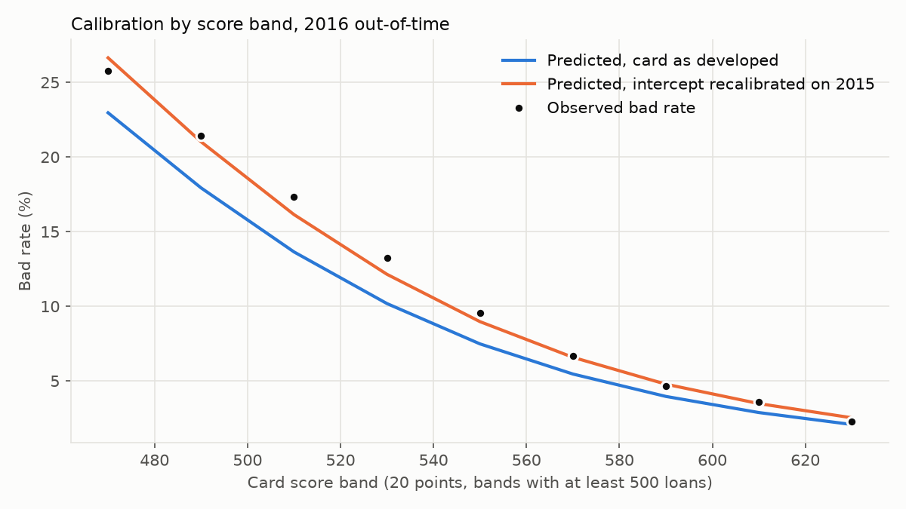
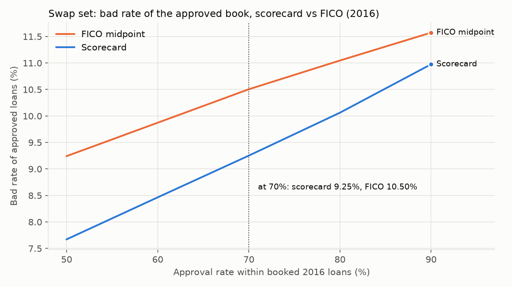

# score-pilot-lab

This is a consumer credit scorecard built on Lending Club loans from 2007 to 2018, developed and tested the way a score vendor would take a new score to a lender. The model sees only what was known on the day of the application, predicts serious delinquency over the first two years of the loan, and is judged against FICO on loans it never saw during development.

The analytics are written once, in a small Python package, and the notebooks call it rather than repeating the work. Every number in a report therefore comes from the same code path as the number in the notebook.

**Headline results.** On the 2016 out-of-time loans the scorecard reaches a Gini of 0.284 against 0.181 for the FICO midpoint, a lift of 0.103 (bootstrap 95% interval 0.098 to 0.109); Lending Club approved largely on FICO, so FICO's range is truncated in these loans and the lift is measured over a truncated incumbent. At a matched 70% approval rate within the booked loans, the approved book's bad rate is 9.25% under the scorecard against 10.50% under FICO. A tuned XGBoost with monotone constraints adds 0.0215 Gini over the scorecard (95% interval 0.0194 to 0.0235). About two thirds of that kind of gain comes from the wider input set rather than the model form: in notebook 07 an XGBoost limited to the scorecard's eight attributes gains only 0.0072 of a 0.0208 lift.

## What the project covers

The work follows the order a model developer would actually go through.

It starts with a data audit: which fields exist in which years, where reporting has gaps, and which loans belong in scope. The target and the sample come next. A loan is bad if it reaches 90 or more days past due within 24 months of issue, and loans are split by vintage into training, validation, an out-of-time test year and a monitoring period.

From there the project builds an attribute library limited to fields known at application, groups each attribute into monotone bins with weight of evidence, and fits a logistic scorecard. The scorecard is scaled to a 300 to 850 range and produces adverse-action reason codes for every applicant.

Two pieces test the scorecard's assumptions. Reject inference asks how much the model is distorted by having learned only from approved loans. Gradient-boosting challengers (XGBoost and LightGBM, with monotone constraints) ask how much performance a more flexible model would add, and whether that gain survives once it has to be explained.

Notebooks 07b to 07e widen that comparison. Notebook 07b adds an explainable boosting machine (with and without pairwise interactions), a monotone random forest, a small neural network (MLP) on raw and on binned inputs, and a stacked ensemble, all tuned and chosen on the 2015 validation year. Notebook 07c explains the boosted model and tests whether its interactions or reason codes should carry back into the scorecard. Notebook 07d fits a discrete-time hazard model, with prepayment as a competing outcome, to see what the timing of default adds. Notebook 07e is an illustrative causal example: double machine learning for the difference in bad rate between 60- and 36-month loans. The monitoring rule in notebook 09 judges each quarter's Gini against its own confidence interval and against the Gini the scorecard expects on that quarter's population if its probabilities were right, and it acts only when a shortfall persists for two quarters in a row.

The pilot report is written the way a lender would read it: discrimination with confidence intervals, calibration by score band, gains tables, and swap sets against FICO at a matched approval rate, meaning the applicants the new score would approve that FICO declines and the reverse. The last step is monitoring, with population and characteristic stability over time and a simple rule for when to recalibrate, re-estimate or rebuild.

## Data

The source is the public Lending Club data on Kaggle: one file of accepted loans and one of rejected applications. Both are loaded into a local DuckDB database with explicit types.

| Object | Rows | What it is |
|---|---:|---|
| `accepted` | 2,260,668 | Every funded loan, 151 columns, issued June 2007 to December 2018 |
| `rejected` | 27,648,741 | Rejected applications, nine columns, no outcome |
| `v_accepted_asof` | 2,260,668 | Accepted loans restricted to fields known at application (71 columns) |
| `v_target` | 2,260,668 | One row per loan with the 24-month label and its supporting flags |
| `v_split` | 2,260,668 | `v_target` plus the development role of each loan |

The accepted file has 33 trailing summary lines ("Total amount funded in policy code ...") that are not loans; they are dropped at load time. Kaggle's archive does not include Lending Club's data dictionary, so field meanings are taken from the column names and Lending Club's public documentation.

Every notebook after the first reads `v_accepted_asof`, never the raw table. The list of allowed fields lives in `data/reference/as_of_application_fields.csv`, which makes the leakage control a file you can read and review rather than a habit. FICO at origination is kept as the benchmark the new score is compared against.

## How the target is built

Lending Club does not publish a monthly payment history. Each loan has a final status (Fully Paid, Charged Off, Current, Late and so on) and the date of its last payment. The 24-month label is reconstructed from those two fields: for a loan that ended badly, the month of the last payment plus three missed payments gives an estimate of when it reached 90 days past due. If that falls within 24 months of issue, the loan is bad.

This is a proxy, and it is described as one. A borrower who fell 90 days behind, caught up and later paid off the loan looks like a good loan in this data, so the observed bad rate is a lower bound on the true one. Partial payments while delinquent also push the estimated date later than it really was. The reasoning and the exact rules are recorded in `docs/decisions.md` (entry of 27 October 2026).

A loan only gets a label once its full 24-month window has closed. The data snapshot is 1 March 2019, so loans issued after March 2017 have no 24-month label. They are kept for stability monitoring and for an early indicator with a shorter horizon, but they are never used to fit or test the model. Loans that miss their first payment inside the 24 months but only reach 90 days past due just after it, in months 25 to 27, are boundary-timing cases rather than mild delinquencies; almost all of them later charged off. They are marked indeterminate and left out of fitting.

## Sample design

Loans are split by issue year, so every test is out of time as well as out of sample.

| Role | Issue dates | Bad | Good | Indeterminate | Bad rate |
|---|---|---:|---:|---:|---:|
| Train | 2013 to 2014 | 35,005 | 329,769 | 5,669 | 9.60% |
| Validate | 2015 | 47,405 | 366,386 | 6,793 | 11.46% |
| Out-of-time test | 2016 | 50,591 | 369,020 | 6,007 | 12.06% |
| Monitor (labeled) | Jan to Mar 2017 | 9,803 | 81,088 | 1,481 | 10.79% |

Bad rate is bad divided by bad plus good. Loans issued before 2013 (95,902, including 2,749 that did not meet Lending Club's credit policy) are out of scope, and loans from April 2017 onward are monitored without labels. Joint applications (120,710) are excluded from every role: none were issued in the training years, and the joint-application fields are left out of this version.

The bad rate rises from about 9.6% in training to 12.1% in the test year. A model fit on 2013 to 2014 can rank 2016 borrowers well and still under-predict their risk, so the pilot report checks calibration by score band separately from ranking.

The first notebook shows why training starts in 2013. A block of 21 bureau fields was not reported for loans issued from January to August 2012, so in 2012 a missing value would mark the issue date rather than anything about the borrower. Another block of seven fields only exists from 2016 and is not used. Where training starts is set in `config.TRAIN_VINTAGES`, and changing it means rebuilding the views with `make views`.

## Getting started

The project needs Python 3.11 or 3.12, a Kaggle API token, and about 8 GB of free disk for the raw files and the database. The commands below are for Windows PowerShell; on macOS or Linux, activate the environment with `source .venv/bin/activate` instead.

```bash
py -3.12 -m venv .venv
.\.venv\Scripts\Activate.ps1
python -m pip install --upgrade pip
pip install -r requirements.txt
python -m ipykernel install --user --name score-pilot-lab
```

`requirements.txt` installs the analytics, the developer tools, Jupyter, and the project itself in editable mode. Use it to install; `requirements-lock.txt` records the exact versions used for the results.

Copy `.env.example` to `.env`. If the repository sits in a synced folder such as OneDrive or Dropbox, set `RAW_DATA_DIR` and `DUCKDB_PATH` there to keep the large files outside it.

Then build the data and check that everything runs:

```bash
make data        # download from Kaggle into the raw data folder
make db          # load the CSVs into DuckDB with typed tables and views
make views       # rebuild v_target and v_split after changing the target or scope
make test
```

Without GNU make, run the scripts directly: `python scripts/download_data.py`, `python scripts/build_db.py` and `python scripts/refresh_views.py`.

## Working through the notebooks

Each notebook settles one question, shows the evidence, and leaves short decision cells where the modelling choice and its reasoning are written down. They run in order, and each one reads what the previous ones saved under `models/`. Setting `SAMPLE_FRAC` in the third cell gives a quick run on a sample; leave it as `None` for the fit that goes into the report.

| Notebook | What it settles | What it writes |
|---|---|---|
| 01 Data audit | Scope by year, term and application type; fields with structural gaps | `models/audit_decisions.json`, `docs/audit/` |
| 02 Sample design | Window, bad event, indeterminates, exclusions, split | An entry in `docs/decisions.md` |
| 03 Attribute library | Attribute families, derived attributes, candidate list | `models/candidate_attributes.json` |
| 04 Classing and WOE | Binning settings, edge overrides, information-value and stability screens | `models/bins.json` |
| 05 Scorecard | Selection rules, forced variables, scaling, reason codes | `models/champion/`, points table |
| 06 Reject inference | Simulation design and which method the pilot reports, self-training included | Comparison table |
| 07 Challengers | Constraints, tuning, what carries back to the scorecard | `models/challenger_xgb.json` |
| 07b Challenger models | Which model families to compare, the tuning budget, and which challenger goes forward | `models/challenger_xgb_tuned.json`, `models/challenger_tuning.json`, comparison table |
| 07c Explainability | Which interactions carry back into the scorecard, and whether the GBM's reason codes would hold up | Interaction and reason-code tables |
| 07d Survival | How the hazard model is specified, and what timing adds to the scorecard | Hazard-versus-scorecard comparison, default curves by score band |
| 07e Causal example | The controls and the estimand for the 60- versus 36-month comparison | Effect estimates (illustrative) |
| 08 Pilot report | Approval rate, segments, fairness checks, interpretation | `docs/pilot_report/pilot_report.md`, `docs/figures/` |
| 09 Monitoring | Thresholds, cadence and the action for each drift scenario | `docs/monitoring/` |

Notebooks 07b to 07e build on notebook 07. They read the champion scorecard, the candidate attributes and the bins saved by notebooks 03 to 05, and 07c also reads the tuned challenger that 07b saves. In 07b every model is tuned and early-stopped on the 2015 validation year only, so the 2016 comparison stays a true out-of-time test. It needs Optuna and interpret, and both are in `requirements.txt`.

## The analytics package

All of the modelling lives in `src/scorelab`. The notebooks stay thin and call these functions.

| Module | What it does |
|---|---|
| `data` | The single DuckDB connection, read-only loaders and profiling helpers |
| `target` | The label and split views, vintage curves, window sensitivity, prior correction |
| `attributes` | Attribute registry with meaning, expected direction and missing-value treatment; leakage checks |
| `binning` | Monotone coarse classing, WOE and IV, overrides, characteristic stability |
| `scorecard` | Logistic fit with stepwise selection, sign and correlation guards, PDO scaling, reason codes |
| `reject_inference` | A simulated reject region with known truth; hard cutoff, parceling, fuzzy augmentation and self-training |
| `challengers` | Constrained XGBoost and LightGBM, random forest, EBM, a small neural network, a stacked ensemble; TreeSHAP, GBM reason codes, a surrogate tree |
| `tuning` | Hyperparameter search for the GBM and the neural network, scored on the validation year only |
| `explain` | Partial dependence, pairwise interaction strength, crossed attributes carried back into the scorecard, reason-code agreement |
| `survival` | A discrete-time hazard by months on book, with prepayment as a competing outcome, and cumulative default curves |
| `causal` | Double machine learning for the illustrative term comparison, with overlap checks and simple benchmarks |
| `validation` | AUC, Gini and KS with DeLong intervals, gains tables, swap sets, calibration, PSI, a comparison table for several models |
| `fairness` | Adverse impact ratio, standardized mean difference, group calibration, a search for a less discriminatory alternative |
| `report` | Every pilot number from one call, and the assembled markdown report |
| `monitoring` | PSI and CSI by period, early-indicator tracking, drift simulation, the recalibrate or rebuild rule |

## Repository layout

| Path | Contents |
|---|---|
| `data/raw/`, `data/lc.duckdb` | Downloaded files and the database (not in Git) |
| `data/reference/` | The as-of-application field list; always kept in the repository |
| `docs/` | Model card, model document in SR 11-7 style, decision log, pilot report, figures, monitoring plan |
| `notebooks/` | One notebook per step |
| `src/scorelab/` | The analytics package; `config.py` holds paths and constants |
| `models/` | Artifacts passed between notebooks |
| `dashboard/` | A Streamlit view of the stability reports |
| `scripts/`, `tests/` | Data scripts and the pytest suite |

## Current state

The database was built on 25 October 2026, and the target views were last rebuilt on 31 October after the scope decisions (training from 2013, joint applications excluded), with the counts shown above. All notebooks, 01 to 09 including 07b to 07e, ran on the full data between 31 October and 2 November 2026; every result in this README comes from those runs. An earlier run on a 5% sample is kept in `models/_smoke_test_5pct/` and `docs/_smoke_test_5pct/` only as an example of a quick run, not as a result. Raw-file sizes and checksums are in `docs/decisions.md`.

## Out of scope on Lending Club data

Two pieces of the wider study cannot be built on this data and are not attempted here.

An account-management (behaviour) model needs monthly performance on open accounts: balances, payments and utilisation over time. Lending Club publishes one snapshot per loan, not a payment history.

A real fair-lending search for a less discriminatory alternative needs protected-class data, or a validated proxy such as one built from surname and geography. Lending Club has neither. The `fairness` module shows the method on a geographic proxy only.

Both are planned as a separate module.

## Results

All results are on the 2016 out-of-time vintage (419,611 labelled loans, bad rate 12.06%), from notebooks 06 to 09. Figures are in `docs/figures/`.

| Model | Gini [95% CI] | KS | Calibration slope | Calibration intercept |
|---|---|---:|---:|---:|
| Scorecard (champion, as developed) | 0.2838 [0.2789, 0.2888] | 0.2080 | 1.0117 | 0.2869 |
| XGBoost, tuned, monotone | 0.3053 [0.3004, 0.3102] | 0.2214 | 0.9207 | 0.1095 |
| XGBoost, tuned, recalibrated on 2015 | 0.3053 [0.3004, 0.3102] | 0.2214 | 0.9463 | −0.0157 |
| EBM, monotone, main effects | 0.2995 [0.2946, 0.3045] | 0.2163 | 0.9766 | 0.2285 |
| FICO midpoint (incumbent) | 0.1805 [0.1754, 0.1855] | 0.1354 | — | — |

The calibration slope and intercept come from a logistic fit of the outcome on each model's predicted log-odds; a slope of 1 and an intercept of 0 mean the model's probabilities carry over to 2016 as they are. FICO is a score rather than a probability, so it has none, and its range is truncated in this population (see Limitations). The tuned XGBoost leads the monotone EBM by 0.0058 Gini (paired DeLong 95% interval 0.0048 to 0.0068): a real but small price for a model whose every effect is a readable curve.



**Calibration.** The scorecard ranks 2016 correctly (slope 1.012) but under-predicts its level: 9.60% predicted against 12.06% observed, because the bad rate rose from 9.60% in the training years to 11.46% in 2015. Moving only the intercept to the 2015 bad rate (prior correction, +0.198 log-odds), which is the version a lender would deploy at the start of 2016, gives 11.41% predicted and leaves 3 of 11 score bands outside their 95% interval, against 8 of 11 before. The tuned XGBoost, recalibrated on 2015 with a two-parameter logistic map, predicts 11.17%.



**Swap set.** At a 70% approval rate, applied to the loans Lending Club booked in 2016, the scorecard and FICO approve the same number of loans. The 66,965 loans the scorecard would approve instead of FICO's go bad at 11.99%, and the 66,965 it would decline instead go bad at 17.48%. The approved book's bad rate falls from 10.50% to 9.25%, or 125 fewer bads per 10,000 approvals; the gain is 157 per 10,000 at a 50% approval rate and 60 at 90%. This is a reordering within loans Lending Club already approved, not a statement about the applicants it declined.



**Reject inference.** On a simulated reject region (20% of the development loans declined on FICO, with their outcomes hidden), no method recovered the ranking of the declined loans materially better than the scorecard fitted on approved loans alone: Gini on the declines was 0.2283 for that scorecard and 0.2327 for the best method, self-training. None estimated their bad rate well either: the hidden truth was 14.07%, and the estimates ran from 12.61% to 25.19%. Fuzzy augmentation changed no decision at a 70% approval rate. The pilot therefore reports the booked population.

**Survival model.** A discrete-time hazard on the scorecard's eight attributes, with prepayment as a competing outcome, ranks 2016 the same as the scorecard: its cumulative default at 24 months has a Gini of 0.2834 against 0.2838 (difference −0.0005, 95% interval −0.0011 to 0.0002), and a rank correlation of 0.992 with the scorecard's probability. What it adds is timing: cumulative default curves by score band, a candidate early indicator for vintages that are not yet 24 months old.

**Monitoring.** Notebook 09 monitors the deployed scorecard, with its intercept recalibrated on 2015, quarter by quarter. Calibration stays within bounds in every quarter, and the population stability index stays between 0.0010 and 0.0130. 2016Q1 ranks well above its expected Gini (0.313 against 0.286). From 2016Q3 the observed Gini falls below what the scorecard expects on each quarter's loans: a first breach in 2016Q3 gives watch (0.2610 against 0.2723), the second in 2016Q4 gives re-estimate (0.2575 against 0.2753), and 2017Q1 breaches again (0.2644 against 0.2768). Of the three simulated drifts, a covariate shift lands on "investigate population, no model change": its Gini falls, but only as far as the scorecard expects on the narrower population (0.2613 against 0.2584). A concept shift lands on recalibrate, and an ordering decay on re-estimate.

## Limitations

The label is a proxy built from the last payment date, and it undercounts borrowers who fell behind and later recovered.

Lending Club approved largely on FICO, so FICO's range is truncated in this population (no loan below a FICO midpoint of 662 in these vintages) and its Gini here understates what FICO does on all applicants. The comparison with FICO shows ranking within the booked population, not a head-to-head on every applicant.

The model learns only from funded loans. The rejected file has nine fields and no outcomes, so reject inference is tested on a simulated reject region where the truth is known, and the results show how the methods behave rather than what Lending Club's rejected applicants would have done.

The out-of-time split is chronological but retrospective: some of the labels used for validation matured after a model built at the start of 2016 would already have been in use.

Lending Club data has no protected attributes. The fairness checks in the pilot report show the method on a proxy grouping, not a finding about real disparities.

Lending Club is a marketplace lender, not a credit bureau, and its application data mixes bureau-derived fields with Lending Club's own. The model is a bureau-style scorecard in method and design, not a bureau score.

## Disclaimer

This is an independent project built on public data for learning and demonstration. It does not use or describe the models, data or practices of any lender or score vendor.
